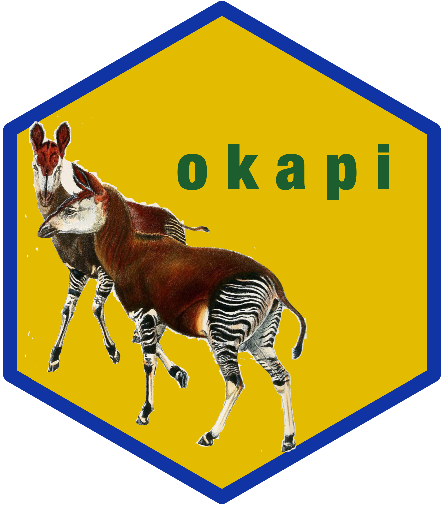

<!-- README.md is generated from README.Rmd. Please edit that file -->

# okapi: Open Data Kit (ODK)-based Computer-assisted Personal Interview (CAPI) Tools 

<!-- badges: start -->

[](https://www.repostatus.org/#active)
[](https://www.tidyverse.org/lifecycle/#experimental)
[](https://github.com/rapidsurveys/okapi/actions/workflows/R-CMD-check.yaml)
[](https://github.com/rapidsurveys/okapi/actions)
[](https://app.codecov.io/gh/rapidsurveys/okapi)
[](https://www.codefactor.io/repository/github/rapidsurveys/okapi)
[](https://zenodo.org/badge/latestdoi/206914853)
<!-- badges: end -->

Data collection using computer-assisted personal interviewing (CAPI)
tools is now the standard approach for conducting surveys and studies. A
wide range of CAPI systems are currently being used. The ability to
interface with these systems helps in the overall data process. This
package provides interface functions to CAPI systems based on the [Open
Data Kit (ODK)](https://getodk.org) technology.

<!-- ## Motivation and development history
&#10;## The ODK ecosystem -->

## What does the package do?

Currently, `{okapi}` provides functions to interface with
[ONA](https://getodk.org) via its
[API](https://api.ona.io/static/docs/index.html). The current set of
functions perform the following tasks:

1.  Authenticate with the respective servers using either an account
    password or an API token;

2.  List resources in the server available to interface with; and,

3.  Get data or resources from the server to
    [R](https://cran.r-project.org).

## Installation

`{okapi}` is not yet on [CRAN](https://cran.r-project.org) but can be
installed from the [RapidSurveys R
Universe](https://rapidsurveys.r-universe.dev) with:

``` r
install.packages(
  "okapi", 
  repos = c(
    'https://rapidsurveys.r-universe.dev', 'https://cloud.r-project.org'
  )
)
```

## Usage

### Authentication

### List resources

### Retrieve resources

## Citation

If you use `{okapi}` in your work, please cite using the suggested
citation provided by a call to the `citation` function as follows:

``` r
citation("okapi")
#> To cite okapi in publications use:
#> 
#>   Ernest Guevarra (2026). _okapi: Open Data Kit (ODK)-based
#>   Computer-assisted Personal Interview (CAPI) Tools_.
#>   doi:10.5281/zenodo.206914853
#>   <https://doi.org/10.5281/zenodo.206914853>, R package version 0.1.2,
#>   <https://rapidsurveys.io/okapi/>.
#> 
#> A BibTeX entry for LaTeX users is
#> 
#>   @Manual{,
#>     title = {okapi: Open Data Kit (ODK)-based Computer-assisted Personal Interview (CAPI) Tools},
#>     author = {{Ernest Guevarra}},
#>     year = {2026},
#>     note = {R package version 0.1.2},
#>     url = {https://rapidsurveys.io/okapi/},
#>     doi = {10.5281/zenodo.206914853},
#>   }
```

## Community guidelines

Feedback, bug reports and feature requests are welcome; file issues or
seek support [here](https://github.com/rapidsurveys/okapi/issues). If
you would like to contribute to the package, please see our
[contributing
guidelines](https://rapidsurveys.io/okapi/CONTRIBUTING.html).

This project is released with a [Contributor Code of
Conduct](https://rapidsurveys.io/okapi/CODE_OF_CONDUCT.html). By
participating in this project you agree to abide by its terms.

 

[](https://rapidsurveys.io)
